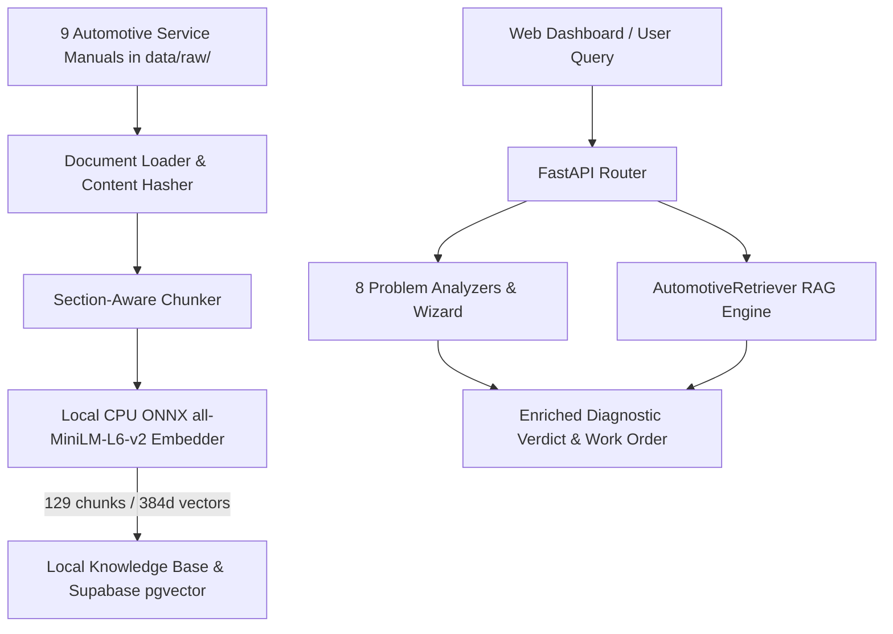

# AutoAssist AI: Intelligent Automotive Diagnostic and Service Assistance Platform

[](https://www.python.org/)
[](https://fastapi.tiangolo.com/)
[-orange.svg)](https://huggingface.co/sentence-transformers/all-MiniLM-L6-v2)
[](https://www.docker.com/)
[]()

**AutoAssist AI** is a production-grade, deployable intelligent automotive diagnostic platform. It combines a sub-100ms semantic RAG retrieval engine over technical factory service manuals with **8 dedicated subsystem problem analyzers**, an **interactive guided diagnostic wizard**, and a **modern, responsive web application interface**.

---

## 🌟 Key Capabilities & Features

### 1. Modern Deployable Web Diagnostic Dashboard
- **Instant Browser Access**: Served directly by FastAPI on `http://127.0.0.1:8000/`.
- **Dynamic Vehicle Profile Selector**: Choose Make (Honda, Toyota, Ford, Generic), Model, Model Year, and Mileage.
- **Cyberpunk / Automotive Dark Theme & Light Mode Toggle**: Polished UI with glassmorphism cards and neon status indicators.
- **Printable / Exportable Repair Orders**: One-click mechanic repair order generation with root causes, action steps, toolkits, and cost estimates.

### 2. Dedicated Automotive Problem Analyzers
1. **OBD-II Diagnostic Trouble Code (DTC) Scanner**:
   - Decodes Powertrain (P), Chassis (C), Body (B), and Network (U) trouble codes.
   - Live Freeze-Frame interpretation: evaluates Short/Long Term Fuel Trims, Engine RPM, Coolant Temp, and System Voltage.
2. **Starting, Charging & Multimeter Analyzer**:
   - State of Charge (SoC%) calculation from resting battery open-circuit voltage.
   - Starter cranking voltage drop evaluation (minimum 9.6V threshold).
   - Alternator voltage regulation under load (13.8V – 14.6V) and overcharging alert (>15.0V).
   - Key-off parasitic draw test (<50mA normal vs battery-draining draw).
3. **Engine Overheating & Cooling System Investigator**:
   - Isolates causes based on driving condition (idle/traffic vs highway cruising vs rapid spike).
   - Diagnostic tests for stuck thermostat, radiator fan relay, water pump impeller slippage, and blown head gasket.
4. **NVH Sound & Vibration Acoustic Identifier**:
   - Pinpoints failing components based on sound frequency (squeal, grind, rhythmic click, deep knock, whine, clunk).
   - Correlates with speed-dependent and engine RPM-dependent telemetry.
5. **Brake System Safety & Wear Evaluator**:
   - Interactive brake pad millimeter slider with color-coded safety zones (>6mm Healthy, 3–4mm Service Soon, ≤2mm Critical).
   - Evaluates spongy pedal, master cylinder internal seal bypass, and rotor lateral runout.
6. **Transmission & Drivetrain Health Analyzer**:
   - Covers Automatic, CVT, Manual, and DCT transmissions.
   - Diagnostic fluid color chart (Cherry Red, Brown, Black, Pink Milkshake coolant breach).
   - Torque converter clutch shudder diagnosis at 35–50 MPH.
7. **Fuel Trim, Economy & Emissions Analyzer**:
   - Calculates stoichiometric combustion balance using STFT and LTFT fuel trims.
   - Differentiates vacuum leaks (high trim at idle, normal at 2500 RPM) from Mass Airflow (MAF) sensor faults.
   - Exhaust smoke color diagnostics (black soot, blue oil burning, white sweet coolant vapor).
8. **Multi-Step Interactive Diagnostic Wizard**:
   - Guided decision-tree workflow for no-start, overheating, abnormal noise, and brake weakness.
   - Computes weighted cause likelihoods and outputs a certified repair work order.
9. **Repair Cost & Labor Benchmark Guide**:
   - Industry-standard cost benchmarks for DIY parts, professional mechanic labor hours, total shop price, and 1-to-5 wrench difficulty scores.

---

## 🏗️ Architecture & Semantic RAG System



---

## 🚀 Getting Started & Deployment

### Quick Local Start (Windows)
Double-click [`run_server.bat`](file:///c:/Users/anasa/OneDrive/Desktop/autoassistAI/run_server.bat) or run from PowerShell:
```powershell
.\run_server.bat
```
The server starts on port 8000 and automatically launches your browser at `http://127.0.0.1:8000/`.

### Run via Python
```bash
pip install -r requirements.txt
uvicorn backend.app.main:app --reload --host 127.0.0.1 --port 8000
```

### Docker Deployment
```bash
# Build image
docker build -t autoassist-ai:latest .

# Run container
docker run -d -p 8000:8000 --name autoassist-ai autoassist-ai:latest

# Or use Docker Compose
docker compose up -d --build
```

For Render, Railway, Fly.io, and Linux VPS deployment instructions, see [DEPLOYMENT.md](file:///c:/Users/anasa/OneDrive/Desktop/autoassistAI/DEPLOYMENT.md).

---

## 🧪 Testing

Run the comprehensive 20-test test suite covering all API endpoints, RAG retrieval, and problem analyzers:
```bash
python -m pytest tests
```
Result: **20 passed, 0 failures**.
