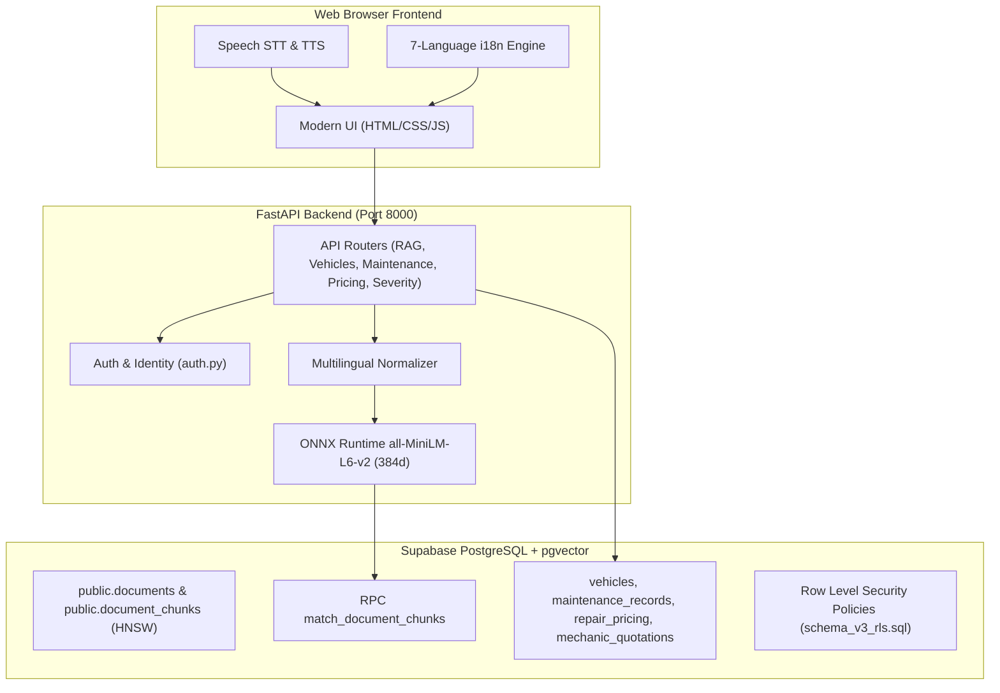

# AutoAssist AI: Intelligent Automotive Diagnostic and Service Assistance Platform

[](https://www.python.org/)
[](https://fastapi.tiangolo.com/)
[-orange.svg)](https://huggingface.co/sentence-transformers/all-MiniLM-L6-v2)
[](https://supabase.com/)
[]()
[]()

**AutoAssist AI** is a production-grade, multilingual, voice-enabled automotive intelligence platform. It bridges the information gap between vehicle owners and mechanics by translating technical factory service manuals into accessible explanations, providing verified spare parts and labor cost benchmarks, evaluating repair quotations, and managing vehicle maintenance schedules.

> [!NOTE]
> **Product Philosophy & Disclaimer**: AutoAssist AI provides educational insights and reference benchmarks. It is designed to empower everyday drivers with mechanical understanding and confidence; it does not replace certified professional mechanics or function as a certified physical diagnostic inspection tool.

---

## 🌟 Core Modules & Capabilities

### 1. Multilingual Support (7 Languages)
Complete internationalization across all interface components, forms, warnings, and dialogs:
- **English (`en`)**
- **Kannada (`kn` — ಕನ್ನಡ)**
- **Hindi (`hi` — हिन्दी)**
- **Urdu (`ur` — اردو, RTL)**
- **Malayalam (`ml` — മലയാളം)**
- **Tamil (`ta` — தமிழ்)**
- **Telugu (`te` — తెలుగు)**

Includes automatic query normalization bridging non-English vernacular symptoms to technical automotive terms for high-precision vector search.

### 2. Voice Input & Voice Output
- **Hands-Free Speech-to-Text (STT)**: Direct microphone input via the Web Speech API in all 7 supported locales.
- **Natural Text-to-Speech (TTS)**: One-click playback of AI explanations with customizable pitch and speech rate.

### 3. Semantic RAG Architecture (Retrieval-Augmented Generation)
- **Local Embedding Model**: `sentence-transformers/all-MiniLM-L6-v2` executed via ONNX Runtime on CPU (384 dimensions).
- **Vector Database**: Supabase PostgreSQL + `pgvector` with HNSW indexing for sub-100ms cosine similarity retrieval (`match_document_chunks` RPC).
- **Dual-View Manuals**: Displays original OEM manual passages alongside structured plain-language explanations, symptoms, root causes, and non-confrontational questions for mechanics.

### 4. Vehicle Profile & Ownership Management
- CRUD vehicle profiles (make, model, year, fuel type, engine variant, odometer).
- Strict user authorization with Supabase Auth token extraction (`auth.py`) and Row Level Security (RLS) policies.

### 5. Transparent Cost Estimator & City Labor Benchmarks
- Indian Rupee (₹) spare parts and labor calculations based on verified manufacturer standards.
- Dynamic hourly labor rates across major cities (Bengaluru ₹750/hr, Mumbai ₹800/hr, Delhi/NCR ₹750/hr, Pune ₹700/hr, Hyderabad/Chennai ₹650/hr).

### 6. Mechanic Quotation Evaluation
- Itemized comparison of garage quotes against verified reference price bands.
- Flags items as *Within reference range*, *Above reference range*, or *Below reference range* with contextual advice on OEM warranties and parts tiers.

### 7. Vehicle Maintenance Reminders & Service History
- Real-time tracking of routine service intervals (Engine Oil, Brake Pads, Coolant, Battery, Filters, Tire Rotation).
- Dynamic remaining distance (km) and days calculation with automated status flags (*upcoming*, *due_soon*, *overdue*).
- Cloud persistence via Supabase `maintenance_records` with resilient offline store fallback.

### 8. Diagnostic Problem Analyzers
Dedicated subsystem analyzers for actionable self-service troubleshooting:
- **OBD-II DTC Scanner**: Decodes P, C, B, and U trouble codes with live freeze-frame sensor values.
- **Electrical Multimeter Analyzer**: Battery State-of-Charge (SoC%), starter cranking voltage drop, alternator regulation, and parasitic drain.
- **Thermal & Overheating Investigator**: Diagnoses idle vs highway overheating, thermostats, radiator fans, and head gasket integrity.
- **Brake System Safety & Wear Evaluator**: Pad thickness wear gauge (mm), pedal firmness, and rotor runout.
- **Drivetrain & Transmission Health**: Automatic, CVT, and manual transmission shudder and fluid contamination.
- **Fuel Trim & Emissions Analyzer**: STFT/LTFT mixture ratios, vacuum leak identification, and exhaust smoke analysis.
- **Interactive Guided Diagnostic Wizard**: Step-by-step decision tree for complex multi-symptom diagnostics.

---

## 🏗️ Architecture



---

## 🚀 Getting Started

### Prerequisites
- Python 3.11+
- Git

### 1. Clone & Install
```bash
git clone https://github.com/anasahamed97/Autoassist-AI.git
cd Autoassist-AI
pip install -r requirements.txt
```

### 2. Environment Configuration
Create a `.env` file in the repository root:
```env
SUPABASE_URL=https://your-project.supabase.co
SUPABASE_KEY=your-anon-key
SUPABASE_SERVICE_ROLE_KEY=your-service-role-key

EMBEDDING_MODEL_NAME=sentence-transformers/all-MiniLM-L6-v2
EMBEDDING_DIMENSION=384
CHUNK_SIZE=500
CHUNK_OVERLAP=80
RAG_TOP_K=5
RAG_SIMILARITY_THRESHOLD=0.25

API_HOST=0.0.0.0
API_PORT=8000
```

### 3. Database Migration
Apply the SQL migration scripts in your Supabase SQL editor in order:
1. `sql/schema.sql` (Enables pgvector, documents, chunks, and similarity RPC)
2. `sql/schema_v2.sql` (Creates vehicles, repair_pricing, mechanic_quotations, maintenance_records)
3. `sql/schema_v3_rls.sql` (Configures Row Level Security and access policies)

### 4. Start the Application
Run locally:
```bash
python -m uvicorn backend.app.main:app --reload --host 127.0.0.1 --port 8000
```
Open your browser at `http://127.0.0.1:8000/`.

---

## 🧪 Testing

Run the full automated test suite (32 tests covering RAG, analyzers, auth, vehicle ownership, maintenance persistence, quotation city pricing, and multilingual normalization):

```bash
pytest tests
```

---

## 📄 License
This project is licensed under the MIT License.
